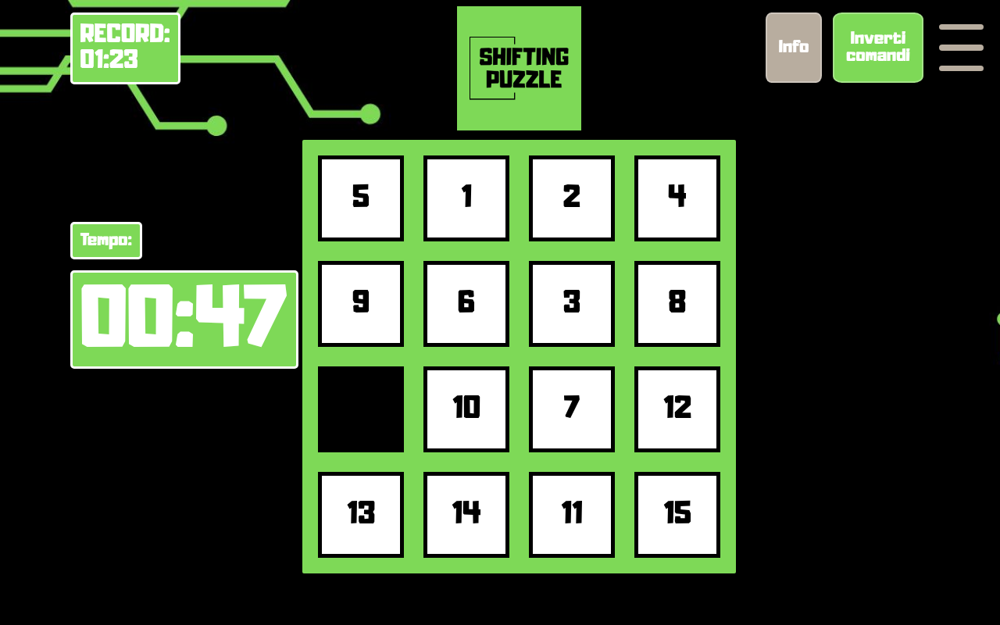
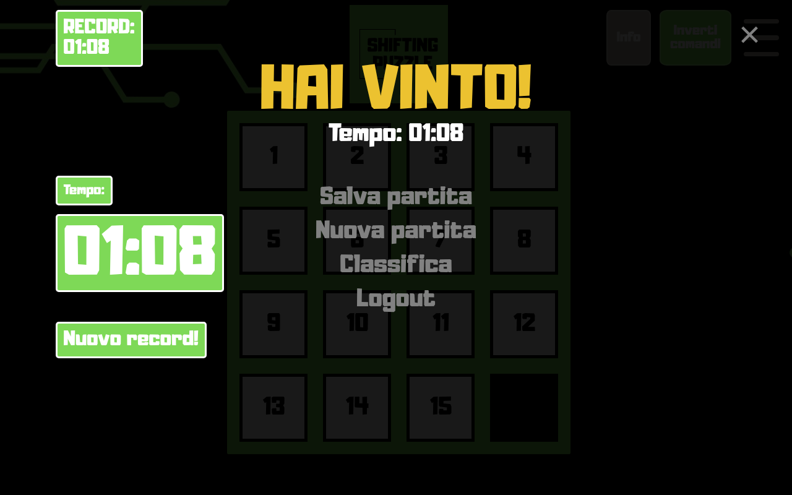
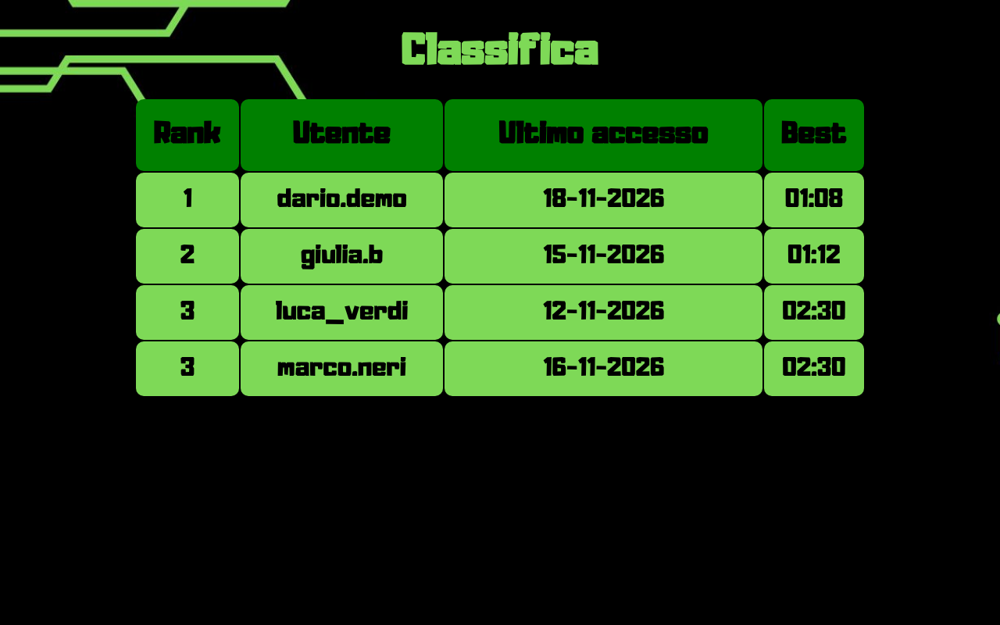
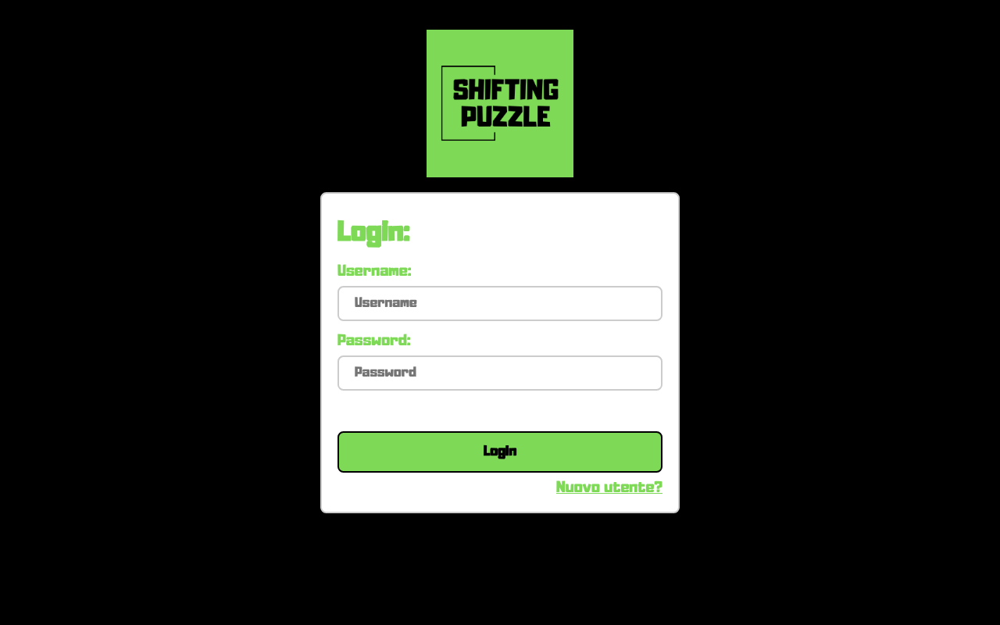
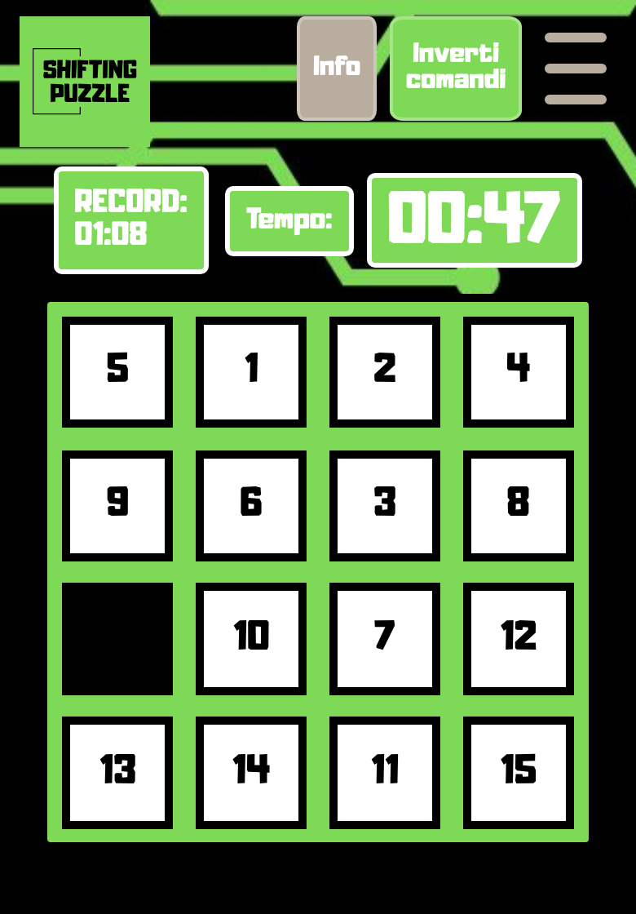

# 🧩 Shifting Puzzle


The classic **15-puzzle** in the browser, with user accounts, saved games and a leaderboard of the best times.
Built for the **Web Design** course (*Progettazione Web*) of the BSc in Computer Engineering, University of Pisa.



## ✨ Features

- **Sign-up and login** with bcrypt-hashed passwords and validation both in the browser and on the server.
- **Always solvable boards**: every new game is shuffled at random and checked with the inversion-count criterion.
- **Two ways to play**: click the tiles next to the empty cell or use the arrow keys, with an option to invert the controls.
- **Timer and personal best**: each user's best time is stored and updated only when it improves.
- **Saved games**: from the menu or automatically on logout; the next login resumes from the last move.
- **Leaderboard** of players sorted by best time, with the date of their last access.
- **Session log**: every login is recorded with start and end time (logout or expiry after one hour).
- **Responsive layout**, playable on mobile too.

## 🛠️ Tech stack

| Layer | Technologies |
|---|---|
| Frontend | HTML5, CSS3 (Grid, Flexbox, media queries), vanilla JavaScript (Fetch API) |
| Backend | PHP 7.4+ with the `mysqli` extension |
| Database | MySQL / MariaDB |

## 🚀 Running locally

You need Apache, PHP and MySQL, for example with [XAMPP](https://www.apachefriends.org/).

1. Clone the project into XAMPP's `htdocs` folder:
   ```bash
   cd /Applications/XAMPP/htdocs        # on Windows: C:\xampp\htdocs
   git clone https://github.com/Dariofala/shifting-puzzle.git
   ```
2. Start **Apache** and **MySQL** from the XAMPP control panel.
3. Create the database by importing `sql/shifting_puzzle.sql`, either from phpMyAdmin
   (`http://localhost/phpmyadmin`, *Import* tab) or from the terminal:
   ```bash
   mysql -u root < sql/shifting_puzzle.sql
   ```
4. Open [http://localhost/shifting-puzzle/](http://localhost/shifting-puzzle/), sign up and play.

### Database configuration

Connection settings live in [`php/config/db.php`](php/config/db.php). Defaults match XAMPP (user `root` with no password,
database `shifting_puzzle`). For other environments set the `DB_HOST`, `DB_USER`, `DB_PASSWORD` and `DB_NAME`
environment variables — no code changes needed.

## 🗂️ Project structure

```
├── index.php               # entry point: redirects to login
├── css/                    # page stylesheets
├── font/                   # Adumu font
├── html/                   # static pages: leaderboard and game rules
├── immagini/               # logo and background
├── javascript/
│   ├── gestioneDB.js       # server communication (fetch + JSON)
│   ├── utilita.js          # shared helpers
│   ├── gioco/              # game mechanics, game state, start-up
│   ├── login/              # login validation and submission
│   ├── registrazione/      # sign-up validation and submission
│   └── classifica/         # leaderboard table
├── php/
│   ├── config/             # database connection and JSON response helpers
│   ├── account/            # login and sign-up pages and endpoints
│   ├── partita/            # game page and game endpoints
│   └── sessione/           # session handling and logout
├── sql/shifting_puzzle.sql # database schema
└── docs/screenshot/        # README images
```

Folder and file names are in Italian, as in the original project.

## 🗄️ Database

| Table | Content |
|---|---|
| `utente` | username, password hash, saved game (board as JSON and elapsed time), best time |
| `logtable` | one row per session: user, start time and end time |

## 🔌 Endpoints

Pages talk to the server through `fetch` requests exchanging JSON.

| Method | Endpoint | Description |
|---|---|---|
| `POST` | `php/account/gestioneRegistrazione.php` | Register a new user |
| `POST` | `php/account/gestioneLogin.php` | Log in and open the session |
| `GET` | `php/partita/statoPartita.php` | Saved game and user's best time |
| `POST` | `php/partita/salvaPartita.php` | Save board and time of the current game |
| `POST` | `php/partita/salvaRecord.php` | Close a won game and update the record if better |
| `GET` | `php/partita/statoClassifica.php` | Leaderboard |
| `GET` | `php/sessione/logout.php` | Close the session and go back to login |

## 🔒 Security

- Passwords are stored only as hashes with `password_hash()` and checked with `password_verify()`.
- All queries use **prepared statements**, so user input cannot alter the SQL.
- Data is validated on the server too (username format, password rules, board and times).
- User-provided text is always rendered as text, never as HTML (`htmlspecialchars`, `textContent`).
- The session ID is regenerated on login and the cookie is `HttpOnly` and `SameSite=Lax`.
- Login returns the same message for an unknown user and a wrong password.

## ⚠️ Known limitations

- Game time is measured in the browser: the server checks its format and accepts a record only if it beats the previous
  one, but a skilled user could still submit a fake time. Preventing this would require validating the moves server-side.
- Sessions last one hour from login; after that the user must log in again.

## 📸 More screenshots

| Victory | Leaderboard |
|---|---|
|  |  |

| Login | Mobile |
|---|---|
|  |  |

## 🙏 Credits

- Adumu font by [Kyle Hathcoat](https://www.dafont.com/kyle-hathcoat.d6847).
- [Poppins](https://fonts.google.com/specimen/Poppins) font (Google Fonts, SIL Open Font License) for the rules page.
- The 15-puzzle was invented by Noyes Palmer Chapman in the 19th century.

## 👤 Author

**Dario Falaschi** — [@Dariofala](https://github.com/Dariofala)
